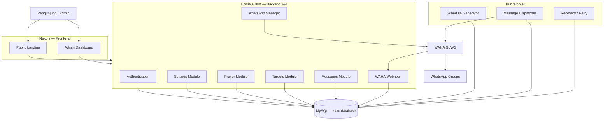

# UNIDA Prayer — Rancangan Teknis V2

> **Dokumen rancangan produk dan teknis** untuk aplikasi pengingat waktu shalat berbasis WhatsApp di lingkungan UNIDA Gontor.
>
> **Status:** Draft rancangan implementasi  
> **Versi dokumen:** 2.0  
> **Tanggal:** 4 November 2026  
> **Nama proyek:** UNIDA Prayer (nama kerja; dapat diganti)

---

## 1. Ringkasan proyek

UNIDA Prayer adalah aplikasi web internal kampus untuk menampilkan informasi waktu shalat dan mengirim pengingat otomatis melalui WhatsApp ke satu atau beberapa grup yang telah dipilih administrator.

Aplikasi merupakan pengembangan dari proyek `vibin_01_prayer_WhatsApp_bot`. Fitur inti proyek lama tetap dipertahankan—lima waktu shalat, pre-reminder, multi-grup, template pesan, tanggal Hijriyah, hadits, dan pengiriman otomatis—tetapi cara pengelolaan konfigurasi, sesi WhatsApp, antrean pengiriman, serta deployment diperbaiki.

Versi baru bukan sekadar script bot. Sistem memiliki:

1. **Public landing page** untuk menampilkan tanggal Masehi, tanggal Hijriyah, lokasi, jadwal shalat, dan countdown waktu shalat berikutnya.
2. **Admin dashboard** untuk mengelola koneksi WhatsApp, grup penerima, lokasi, perhitungan waktu shalat, dan konfigurasi pengingat.
3. **Backend API** sebagai pusat autentikasi, konfigurasi, data, dan integrasi WAHA.
4. **Background worker** untuk membuat dan menjalankan pekerjaan pengiriman pesan.
5. **Penyimpanan database MySQL tunggal** untuk data aplikasi dan antrean pengiriman.
6. **Deployment Docker Compose** dengan image yang dibangun oleh GitHub Actions dan dipublikasikan ke GitHub Container Registry (GHCR).

### 1.1 Tujuan utama

- Mengotomatisasi pengingat lima waktu shalat ke grup WhatsApp kampus.
- Menyediakan halaman publik yang mudah diakses untuk melihat jadwal shalat.
- Memungkinkan administrator mengelola sistem melalui dashboard, tanpa perlu mengubah file `.env` untuk konfigurasi operasional harian.
- Memastikan pekerjaan pengiriman tidak hanya tersimpan di memori proses sehingga dapat dipulihkan setelah aplikasi restart.
- Menjaga kode tetap modular dan mudah dikembangkan tanpa membangun infrastruktur yang berlebihan.

### 1.2 Batasan dan prinsip desain

- Target awal adalah kebutuhan internal UNIDA Gontor, bukan SaaS multi-tenant.
- Sistem mendukung beberapa grup WhatsApp, tetapi versi pertama cukup menggunakan satu sesi WAHA.
- Database aplikasi hanya **satu database MySQL dan satu akun database aplikasi**.
- MySQL dikelola terpisah oleh pemilik server. MySQL tidak menjadi service di `docker-compose.yml` aplikasi.
- Fedora menjadi lingkungan development; database development dapat menggunakan MySQL lokal Fedora.
- Home server Ubuntu menjadi target production; alamat dan kredensial MySQL production diatur sendiri melalui environment.
- Deployment tidak otomatis melakukan SSH atau menjalankan update di server. GitHub Actions hanya menguji, membangun, dan push image. Administrator menjalankan `docker compose pull` dan `docker compose up -d` saat ingin memperbarui server.
- Tidak menggunakan Redis, Kubernetes, microservices, atau sistem antrean eksternal pada versi awal.

---

## 2. Keputusan teknologi yang dikunci

| Area | Teknologi | Keterangan |
|---|---|---|
| Bahasa aplikasi | TypeScript | Digunakan pada frontend, backend, worker, dan shared package |
| Package manager | Bun | Dependency management dan workspace |
| Runtime backend | Bun | Menjalankan Elysia dan worker |
| Frontend | Next.js + TypeScript | Landing page dan admin dashboard; frontend only |
| Runtime frontend production | Node.js container | Menjalankan hasil build Next.js dalam mode standalone |
| Backend | ElysiaJS | REST API dan business logic |
| Database | MySQL | Satu database aplikasi, dikelola di luar Compose aplikasi |
| ORM | Drizzle ORM | Schema, query, dan migration |
| API type sharing | Eden Treaty / tipe package API | Menjaga kontrak frontend dan backend selaras |
| Prayer calculation | `adhan-js` dari proyek lama | Perhitungan waktu shalat offline |
| WhatsApp | WAHA dengan engine GoWS | Sesi dan pengiriman pesan WhatsApp |
| Scheduler | Bun Worker + MySQL | Antrean persisten sederhana berbasis tabel |
| Container | Docker | Menjalankan web, API, worker, dan WAHA |
| Orchestration | Docker Compose | Menjalankan dan memperbarui container |
| Image registry | GHCR | Menyimpan image hasil build GitHub Actions |
| CI | GitHub Actions | Type check, test, dan build/push image saat push ke `main` |

### 2.1 Prinsip TypeScript

Semua source code baru menggunakan TypeScript. File JavaScript lama dari proyek V1 dimigrasikan ke `.ts` atau `.tsx`.

Aturan dasar:

- Aktifkan `strict: true` pada `tsconfig.json`.
- Hindari `any`; gunakan tipe eksplisit atau `unknown` yang divalidasi.
- Validasi input API di backend, bukan hanya mengandalkan validasi frontend.
- Tipe data bersama diletakkan di `packages/shared` atau diambil dari tipe aplikasi Elysia.
- Jalankan type checking secara eksplisit dalam CI. Keberhasilan menjalankan Bun bukan pengganti type checking.
- Frontend tidak boleh mengakses database secara langsung.
- Frontend berkomunikasi dengan backend melalui API.

### 2.2 Catatan runtime Next.js

Elysia dan worker berjalan menggunakan Bun. Untuk deployment Next.js, gunakan output standalone Next.js di container Node.js agar jalur production mengikuti mode deployment Next.js yang umum dan stabil. Kode aplikasi tetap TypeScript dan dependency dapat dikelola melalui Bun Workspace.

---

## 3. Evaluasi proyek V1 dan arah perbaikan

| Komponen V1 | Kondisi / celah | Perbaikan V2 |
|---|---|---|
| `whatsapp-web.js` + Puppeteer | Bergantung pada WhatsApp Web dan browser; rawan perubahan internal WhatsApp Web | Migrasi integrasi ke WAHA GoWS |
| `.env` untuk seluruh konfigurasi | Perubahan lokasi atau target saat runtime tidak permanen tanpa mengubah file | Konfigurasi operasional disimpan di MySQL; `.env` hanya untuk rahasia dan koneksi service |
| `setTimeout` untuk 10 timer harian | Timer berada di memori dan hilang saat proses restart | Pekerjaan disimpan sebagai row di `scheduled_messages` |
| `node-cron` midnight job | Ide membuat jadwal harian tetap digunakan, tetapi harus aman dijalankan ulang | Worker mengisi jadwal ke depan dan membuat row secara idempotent |
| `TARGET_GROUP_IDS` | Menambah atau menghapus grup perlu edit konfigurasi | Grup dikelola dari dashboard dan disimpan di MySQL |
| `ADMIN_PHONES` dan command WhatsApp | Administrasi bergantung pada nomor whitelist dan command chat | Administrasi utama melalui login dashboard |
| `state.json` untuk anti-repeat | State terpisah dari data aplikasi | Simpan referensi konten terakhir pada row pesan; tidak perlu file state untuk fungsi inti |
| Template hardcoded | Sulit dikelola jika ingin mengubah format pesan | Template awal boleh berada di TypeScript; desain kode dibuat agar mudah dipindah ke database di fase berikutnya |
| Hadits lokal 10 item | Pilihan terbatas | Pertahankan library lokal JSON; tambah konten hanya dari sumber yang dapat diverifikasi |
| Hijriyah dari `Intl.DateTimeFormat` | Dapat berbeda dari kalender yang diikuti otoritas lokal Indonesia | Pertahankan sebagai konversi lokal/fallback dan sediakan koreksi tanggal manual |
| `!lokasi` hanya in-memory | Perubahan hilang setelah restart | Perubahan lokasi disimpan ke `app_settings` dan memicu regenerasi jadwal yang belum dikirim |
| Log Winston file | Belum mudah ditampilkan dalam dashboard | Log teknis ke stdout/stderr; status dan hasil pekerjaan disimpan di `scheduled_messages` |
| Belum ada test otomatis | Risiko regresi saat migrasi | Tambahkan unit test dan integration test untuk kalkulasi, generator, dan worker |
| Belum ada Docker/CI | Deployment bergantung pada setup manual | Image dibangun GitHub Actions dan dijalankan melalui Compose |

### 3.1 Fitur V1 yang dipertahankan

- Lima waktu shalat: Subuh, Dzuhur, Ashar, Maghrib, dan Isya.
- Pengingat sebelum waktu shalat (default 3 menit).
- Pengingat tepat pada waktu shalat.
- Dukungan beberapa grup WhatsApp.
- Lokasi berdasarkan latitude dan longitude.
- Tanggal Masehi dan Hijriyah.
- Variasi template pesan.
- Hadits lokal dengan rotasi sederhana dan anti-repeat berurutan.
- Penyesuaian khusus pesan Jumat untuk waktu Dzuhur.
- Reconnect dan pemeriksaan status koneksi WhatsApp.
- Pengiriman ke beberapa target tanpa membiarkan kegagalan satu target menghentikan seluruh target lain.

### 3.2 Fitur V1 yang tidak langsung dipindahkan

- Monkey-patch internal `whatsapp-web.js` untuk Puppeteer. Sudah tidak relevan setelah migrasi ke WAHA.
- Admin commands `!ping`, `!jadwal`, `!status`, dan `!lokasi` sebagai jalur administrasi utama. Dashboard menggantikan fungsi tersebut. Command sederhana dapat dipertimbangkan kemudian, tetapi bukan persyaratan V2.
- Fallback API hadits tanpa verifikasi sumber. Untuk konten agama, sistem tidak boleh mengambil konten acak dari sumber yang belum diverifikasi.
- Deteksi Idul Fitri/Idul Adha hanya berdasarkan pencocokan string tanggal Hijriyah. Gunakan data kalender yang dapat diverifikasi atau input admin jika fitur hari besar dibutuhkan.

---

## 4. Ruang lingkup fitur

## 4.1 Public landing page

Landing page dapat dibuka tanpa login.

### Informasi yang ditampilkan

1. Identitas UNIDA Prayer dan identitas kampus.
2. Hari dan tanggal Masehi.
3. Tanggal Hijriyah.
4. Lokasi jadwal, misalnya UNIDA Gontor / Ponorogo.
5. Lima waktu shalat.
6. Waktu shalat berikutnya.
7. Countdown menuju waktu shalat berikutnya.
8. Penanda waktu yang sedang berlangsung atau waktu berikutnya.
9. Informasi singkat bahwa pengingat WhatsApp digunakan untuk grup yang telah ditentukan kampus.

### Perilaku landing page

- Data jadwal diambil melalui endpoint publik backend.
- Frontend tidak menghitung ulang jadwal shalat sendiri.
- Countdown diperbarui di browser berdasarkan waktu server atau timestamp jadwal dari backend.
- Jika API tidak tersedia, tampilkan pesan bahwa data belum dapat dimuat; jangan menampilkan jadwal palsu atau data hardcoded seolah-olah aktual.
- Waktu ditampilkan dalam zona waktu konfigurasi, default `Asia/Jakarta`.
- Tanggal Hijriyah diberi catatan bahwa hasil kalender dapat memerlukan penyesuaian sesuai keputusan/kalender yang digunakan kampus.

## 4.2 Login dan administrasi

- Halaman login hanya untuk administrator.
- Tidak ada pendaftaran publik.
- Akun admin dibuat melalui perintah seed/bootstrap atau proses administrasi awal.
- Admin dapat mengganti password.
- API admin wajib memeriksa autentikasi dan status akun aktif.
- Semua halaman admin dilindungi; menyembunyikan menu di frontend bukan pengganti proteksi backend.

Untuk versi pertama, satu atau beberapa akun admin dapat disimpan pada tabel `admins`. Hal ini tidak menambah akun MySQL: akun dashboard berbeda dari user koneksi database.

## 4.3 Dashboard overview

Tampilkan ringkasan berikut:

- Status koneksi API.
- Status koneksi database.
- Status sesi WAHA.
- Status worker berdasarkan heartbeat terakhir.
- Waktu shalat berikutnya.
- Jumlah pekerjaan terkirim hari ini.
- Jumlah pekerjaan pending.
- Jumlah pekerjaan gagal atau perlu pemeriksaan.
- Daftar beberapa pengiriman terbaru.

CPU/RAM host secara detail bukan syarat MVP. Pada versi pertama, dashboard cukup menampilkan kesehatan service aplikasi, koneksi database, WAHA, dan heartbeat worker. Monitoring host dapat ditambahkan jika sudah ada kebutuhan nyata.

## 4.4 WhatsApp session management

Versi awal menggunakan satu sesi WAHA.

Fitur dashboard:

- Melihat nama sesi.
- Melihat status sesi.
- Memulai sesi.
- Mengambil dan menampilkan QR pairing ketika dibutuhkan.
- Memeriksa status setelah pairing.
- Menghentikan atau me-restart sesi.
- Logout sesi jika diperlukan.
- Menampilkan informasi akun terhubung jika disediakan WAHA.
- Mengirim pesan percobaan ke target yang dipilih.

Ketentuan:

- Semua request WAHA dilakukan oleh Elysia, bukan langsung dari browser.
- WAHA API key tidak boleh dikirim ke frontend.
- Port WAHA tidak dibuka ke internet publik.
- Data autentikasi sesi disimpan pada persistent volume milik WAHA, bukan di tabel `admins` atau `app_settings`.
- Database hanya menyimpan konfigurasi nama sesi jika diperlukan; status aktual dibaca dari WAHA.
- Gunakan nomor WhatsApp khusus operasional kampus, bukan nomor pribadi utama.

## 4.5 Manajemen grup penerima

- Backend mengambil daftar grup dari WAHA.
- Admin dapat melakukan sinkronisasi daftar grup.
- Admin memilih grup yang akan menerima pesan.
- Admin dapat mengaktifkan atau menonaktifkan target.
- Admin dapat melihat nama dan ID grup.
- Target tidak aktif tidak menerima pekerjaan baru.
- Menghapus target tidak menghapus riwayat pesan yang telah dikirim.

Model data menggunakan `target_type` agar kelak dapat mendukung chat pribadi, tetapi implementasi MVP cukup memprioritaskan grup WhatsApp.

## 4.6 Pengaturan jadwal shalat

Pengaturan minimal:

- Nama lokasi.
- Latitude.
- Longitude.
- Timezone.
- Metode/perhitungan sudut Subuh dan Isya.
- Faktor Ashar.
- Koreksi menit masing-masing waktu shalat.
- Jumlah menit pre-reminder.
- Aktivasi pre-reminder.
- Aktivasi pengingat tepat waktu shalat.
- Koreksi tanggal Hijriyah.

Nilai default awal:

| Pengaturan | Nilai awal |
|---|---|
| Lokasi | UNIDA Gontor / Ponorogo |
| Latitude | `-7.8652` |
| Longitude | `111.4617` |
| Timezone | `Asia/Jakarta` |
| Sudut Subuh | `20°` |
| Sudut Isya | `18°` |
| Faktor Ashar | `1` (Syafi'i) |
| Pre-reminder | `3` menit |
| Prayer engine | `adhan-js` |

Nilai sudut tersebut menjadi konfigurasi awal yang mengikuti parameter yang telah digunakan pada proyek lama. Jadwal harus dibandingkan dengan jadwal rujukan Kemenag yang berlaku di lokasi kampus. Jangan menyatakan hasil perhitungan sebagai jadwal resmi Kemenag sebelum hasilnya divalidasi.

## 4.7 Pesan dan konten

Jenis pesan MVP:

1. Pre-reminder sebelum waktu shalat.
2. Pengingat tepat waktu shalat.

Konten pesan dapat berisi:

- Salam pembuka.
- Nama shalat.
- Tanggal Masehi.
- Tanggal Hijriyah.
- Informasi waktu.
- Ajakan shalat tepat waktu/berjamaah.
- Hadits pilihan dari library lokal jika opsi hadits aktif.
- Identitas UNIDA Prayer.

Ketentuan konten:

- Hadits harus menyimpan sumber/referensi dan teks yang telah diverifikasi.
- Jangan mengandalkan fallback API acak yang belum diverifikasi.
- Hadits tidak boleh berulang secara berurutan jika masih ada pilihan lain.
- Hari Jumat: label waktu Dzuhur dapat diganti menjadi Jumat sesuai template yang disetujui admin.
- Template awal dapat disimpan di source code TypeScript agar sederhana. Struktur fungsi render dibuat modular supaya kelak dapat dipindahkan ke database bila admin perlu mengedit template dari dashboard.
- Pesan yang telah masuk antrean menyimpan snapshot isi pesan, agar perubahan template tidak mengubah pesan yang sudah dijadwalkan.

## 4.8 Riwayat pengiriman

Dashboard menampilkan:

- Tanggal dan waktu jadwal.
- Nama shalat.
- Jenis pesan: pre-reminder atau adzan.
- Target grup.
- Status.
- Jumlah percobaan.
- Waktu terkirim.
- Pesan error terakhir jika gagal.

Untuk menghindari tabel berlebihan, status dan ringkasan percobaan disimpan langsung pada `scheduled_messages`. Log teknis detail tetap dikirim ke stdout/stderr dan dapat dilihat melalui Docker logs.

---

## 5. Arsitektur aplikasi

### 5.1 Gambaran umum



### 5.2 Pembagian tanggung jawab

#### Next.js

- Render landing page.
- Render halaman login dan dashboard.
- Mengelola state UI dan form.
- Mengakses Elysia melalui HTTP API.
- Tidak mengakses MySQL secara langsung.
- Tidak menyimpan WAHA API key.
- Tidak menjalankan scheduler atau pengiriman pesan.

#### Elysia API

- Autentikasi admin.
- Validasi request.
- CRUD pengaturan dan target.
- Menyediakan data jadwal untuk landing page.
- Mengontrol sesi WAHA melalui integration client.
- Menerima webhook WAHA.
- Menyediakan data riwayat dan status sistem.
- Menjalankan pemeriksaan konektivitas database.

#### Bun Worker

- Menjamin jadwal untuk beberapa hari ke depan tersedia.
- Membuat pekerjaan pengiriman secara idempotent.
- Mengambil pekerjaan yang telah jatuh tempo.
- Mengirim pesan melalui WAHA.
- Memperbarui status pekerjaan.
- Melakukan retry terbatas untuk kegagalan sementara.
- Memulihkan pekerjaan yang tertinggal setelah restart.

#### WAHA GoWS

- Mengelola sesi WhatsApp.
- Menyediakan QR pairing.
- Mengambil daftar grup.
- Mengirim pesan teks.
- Mengirim event/status melalui webhook jika tersedia.

WAHA tidak menghitung jadwal shalat dan tidak menentukan kapan pesan harus dikirim. Semua logika tersebut dimiliki aplikasi.

---

## 6. Alur kerja sistem

## 6.1 Startup aplikasi

1. Container web, API, worker, dan WAHA dimulai oleh Docker Compose.
2. API membaca environment dan mencoba koneksi MySQL.
3. API memeriksa konfigurasi dasar aplikasi.
4. Worker memulai heartbeat dan pemeriksaan pekerjaan.
5. Worker memeriksa apakah jadwal untuk beberapa hari ke depan sudah tersedia.
6. Worker membuat pekerjaan yang belum ada.
7. Dashboard mengambil status API, database, worker, dan WAHA.

API dan worker harus melakukan retry koneksi database secara terbatas saat startup jika MySQL belum siap. Jangan membuat aplikasi crash berulang tanpa informasi log yang jelas.

## 6.2 Pairing WhatsApp

1. Admin login ke dashboard.
2. Admin membuka menu WhatsApp Session.
3. Frontend meminta status sesi melalui Elysia.
4. Jika sesi belum terhubung, admin meminta QR.
5. Elysia meminta QR dari WAHA dan mengembalikan data QR yang aman ditampilkan.
6. Admin scan QR menggunakan WhatsApp pada nomor khusus operasional.
7. Dashboard melakukan polling status atau menerima pembaruan status.
8. Setelah status terhubung, admin menyinkronkan grup.

Kredensial sesi disimpan oleh WAHA pada persistent volume. Restart container WAHA tidak boleh menghapus volume tersebut.

## 6.3 Sinkronisasi grup

1. Admin menekan tombol sinkronisasi.
2. Elysia meminta daftar grup ke WAHA.
3. Backend memetakan ID dan nama grup.
4. Grup baru disimpan ke `message_targets` sebagai belum aktif atau mengikuti kebijakan awal yang aman.
5. Grup yang telah ada diperbarui nama/metadata-nya.
6. Admin memilih grup yang akan menerima pengingat.
7. Target aktif digunakan oleh generator ketika membuat pekerjaan baru.

Jangan otomatis mengirim pesan ke semua grup yang ditemukan. Admin harus memilih target secara eksplisit.

## 6.4 Pembuatan jadwal

1. Worker membaca pengaturan lokasi dan metode perhitungan.
2. Worker menghitung lima waktu shalat untuk tanggal lokal.
3. Worker membuat waktu pre-reminder berdasarkan konfigurasi menit.
4. Worker mengambil semua target aktif.
5. Worker membuat satu pekerjaan per kombinasi tanggal, shalat, jenis pengingat, dan target.
6. Pekerjaan disimpan dengan unique key agar generator aman dijalankan ulang.
7. Worker menjaga horizon jadwal, misalnya tujuh hari ke depan.

## 6.5 Pengiriman pesan

1. Worker mengambil pekerjaan `PENDING` yang sudah jatuh tempo.
2. Worker mengklaim pekerjaan secara atomik di MySQL.
3. Worker memeriksa apakah target masih aktif dan sesi WAHA tersedia.
4. Worker mengirim isi pesan melalui WAHA.
5. Jika diterima oleh WAHA, worker menyimpan status `SENT`, waktu pengiriman, dan message ID jika tersedia.
6. Jika gagal sementara, worker menjadwalkan retry.
7. Jika gagal permanen atau telah melewati batas keterlambatan, pekerjaan ditandai `FAILED` atau `EXPIRED`.

Satu target gagal tidak boleh menghentikan pengiriman ke target lain.

## 6.6 Perubahan konfigurasi

Jika admin mengubah lokasi, timezone, metode perhitungan, koreksi waktu, atau pre-reminder:

1. Backend memvalidasi nilai baru.
2. Backend menyimpan nilai ke `app_settings`.
3. Worker mendeteksi perubahan konfigurasi atau menerima sinyal internal sederhana.
4. Pekerjaan masa depan yang masih `PENDING` dihitung ulang.
5. Pekerjaan `SENT` tidak pernah diubah.
6. Pekerjaan `PROCESSING` tidak diubah secara otomatis.
7. Pekerjaan yang tidak lagi relevan dapat ditandai `CANCELLED` atau dihapus sesuai aturan migrasi data yang ditentukan.

Perubahan lokasi tidak boleh mengubah riwayat pesan yang sudah dikirim.

---

## 7. Prayer engine dan kalender

### 7.1 Perhitungan offline

Gunakan `adhan-js` sebagai dasar perhitungan agar sistem tidak memerlukan API eksternal untuk menghitung jadwal setiap hari.

Input perhitungan:

- Tanggal lokal yang dihitung.
- Latitude.
- Longitude.
- Zona waktu.
- Sudut Subuh.
- Sudut Isya.
- Metode/faktor Ashar.
- Koreksi menit setiap waktu jika dikonfigurasi.

Output:

- Subuh.
- Terbit matahari (opsional untuk tampilan/admin, bukan pengingat utama).
- Dzuhur.
- Ashar.
- Maghrib.
- Isya.

Hanya lima waktu shalat utama yang menjadi trigger pengingat.

### 7.2 Zona waktu

- Default `Asia/Jakarta`.
- Jangan mengandalkan timezone OS container.
- Konversi tanggal dan waktu lokal dilakukan secara eksplisit.
- Simpan timestamp pekerjaan dengan konvensi UTC.
- Simpan `prayer_date` sebagai tanggal lokal yang menjadi dasar perhitungan.
- Tampilkan waktu menggunakan timezone dari pengaturan aplikasi.
- Buat test untuk memastikan hasil tidak bergantung pada timezone host/container.

Disarankan menggunakan library timezone yang jelas (misalnya `date-fns-tz`) untuk konversi tanggal lokal dan UTC. Jangan mengandalkan parsing string tanggal secara implisit.

### 7.3 Validasi jadwal

- Bandingkan hasil perhitungan dengan jadwal rujukan Kemenag untuk lokasi kampus.
- Catat selisih per waktu shalat.
- Sediakan koreksi menit yang bisa diatur administrator.
- Jangan mengklaim jadwal hasil `adhan-js` sebagai jadwal resmi tanpa validasi.
- Perubahan metode atau koreksi harus memicu regenerasi pekerjaan yang masih pending.

### 7.4 Tanggal Hijriyah

Implementasi awal boleh mempertahankan `Intl.DateTimeFormat` dengan kalender `islamic-umalqura` seperti proyek lama.

Ketentuan:

- Format bahasa Indonesia.
- Tanggal Hijriyah ditampilkan bersama tanggal Masehi.
- Sediakan `hijri_adjustment_days` dengan rentang terbatas, misalnya -2 sampai +2.
- Koreksi hanya memengaruhi tampilan tanggal Hijriyah, bukan perhitungan waktu shalat.
- Jangan menganggap Umm al-Qura selalu sama dengan kalender yang dipakai otoritas Indonesia.
- Admin dapat melakukan penyesuaian bila kalender kampus menetapkan tanggal berbeda.

### 7.5 Hari Jumat dan hari besar

- Pada hari Jumat, label pengingat Dzuhur dapat menggunakan teks “Jumat” sesuai template.
- Waktu trigger tetap berdasarkan waktu Dzuhur.
- Jangan mendeteksi Idul Fitri/Idul Adha hanya dengan pencarian substring pada tanggal Hijriyah.
- Fitur pesan khusus hari besar dapat ditambahkan setelah ada sumber kalender atau input admin yang dapat dipercaya.

---

## 8. Scheduler dan antrean pesan berbasis MySQL

### 8.1 Prinsip

Jangan menggunakan `setTimeout` sebagai satu-satunya penyimpanan jadwal pengiriman. Timer in-memory boleh digunakan untuk optimasi, tetapi sumber kebenaran harus tetap berada di MySQL.

Worker memeriksa antrean secara berkala. Untuk skala awal satu aplikasi kampus, polling sederhana ke MySQL cukup; Redis atau queue service terpisah belum diperlukan.

### 8.2 Default pengingat

Untuk setiap waktu shalat dibuat dua pekerjaan:

| Jenis | Waktu trigger | Default |
|---|---|---|
| Pre-reminder | Sebelum waktu shalat | 3 menit sebelumnya |
| Adzan reminder | Tepat waktu shalat | Pada waktu shalat |

Dengan lima waktu shalat dan satu target grup, terdapat sepuluh pekerjaan per hari. Jika ada `N` target aktif, generator membuat maksimal `10 × N` pekerjaan per hari, selama kedua jenis pengingat aktif.

### 8.3 Horizon jadwal

- Generator menjaga jadwal untuk tujuh hari ke depan.
- Generator dapat dijalankan berulang kali tanpa membuat duplikat.
- Generator juga berjalan saat worker startup.
- Generator tidak hanya dijalankan pada tengah malam; worker melakukan pemeriksaan berkala agar jadwal tetap terisi.

### 8.4 Status pekerjaan

Status minimum:

| Status | Arti |
|---|---|
| `PENDING` | Menunggu waktu pengiriman |
| `PROCESSING` | Sedang diklaim/diproses worker |
| `SENT` | WAHA telah menerima permintaan pengiriman dengan sukses |
| `FAILED` | Gagal dan tidak akan dicoba lagi secara otomatis |
| `EXPIRED` | Sudah melewati batas keterlambatan sehingga tidak relevan dikirim |
| `CANCELLED` | Dibatalkan karena konfigurasi/target berubah |
| `UNKNOWN` | Hasil pengiriman tidak dapat dipastikan, misalnya request timeout setelah kemungkinan pesan diterima |

### 8.5 Klaim pekerjaan

- Jalankan satu worker instance pada MVP.
- Klaim row menggunakan transaksi dan locking MySQL.
- Gunakan `SELECT ... FOR UPDATE` atau mekanisme klaim atomik lain yang kompatibel dengan versi MySQL.
- Update status menjadi `PROCESSING` sebelum memanggil WAHA.
- Simpan `attempt_count` dan waktu klaim.
- Pastikan ada unique key untuk setiap kombinasi tanggal, shalat, jenis pesan, dan target.

Walaupun hanya satu worker, unique key dan klaim atomik tetap diperlukan untuk mencegah duplikasi saat restart atau jika worker tanpa sengaja berjalan lebih dari satu instance.

### 8.6 Retry

Default awal yang disarankan:

- Maksimal tiga percobaan otomatis untuk kegagalan sementara.
- Jeda bertahap, misalnya 30 detik, 2 menit, lalu 5 menit.
- Jangan retry tanpa batas.
- Jika sesi WAHA terputus, pekerjaan dapat menunggu retry selama belum melewati batas keterlambatan.
- Jika target tidak valid atau pesan ditolak permanen, tandai `FAILED`.
- Jika waktu pengiriman sudah terlalu jauh terlewat, tandai `EXPIRED`.

Batas keterlambatan default dapat dimulai dari lima menit dan dibuat sebagai konfigurasi internal. Pengingat shalat yang sangat terlambat tidak boleh dikirim beberapa jam kemudian seolah-olah masih tepat waktu.

### 8.7 Pencegahan duplikasi dan hasil ambigu

Gunakan `idempotency_key` unik, misalnya hasil hash dari:

`prayer_date + prayer_name + message_type + target_id`

Namun, idempotency di database tidak menjamin WhatsApp tidak menerima duplikasi jika request timeout terjadi setelah pesan dikirim tetapi sebelum respons diterima.

Karena itu:

- Jangan langsung retry semua timeout secara buta.
- Tandai kasus yang hasilnya ambigu sebagai `UNKNOWN` jika tidak dapat direkonsiliasi.
- Simpan WAHA message ID jika respons atau webhook menyediakannya.
- Sediakan pemeriksaan manual untuk status `UNKNOWN`.

### 8.8 Recovery setelah restart

Ketika worker mulai kembali:

1. Cari pekerjaan `PENDING` yang sudah jatuh tempo.
2. Cari pekerjaan `PROCESSING` yang lease/waktu klaimnya sudah terlalu lama.
3. Pekerjaan `PROCESSING` yang belum pernah dikirim ke WAHA dapat dikembalikan ke `PENDING`.
4. Pekerjaan yang mungkin sudah diterima WAHA tetapi responsnya hilang harus ditandai `UNKNOWN`, bukan otomatis dikirim ulang.
5. Jalankan generator untuk melengkapi horizon tujuh hari.

---

## 9. Rancangan database MySQL

### 9.1 Prinsip database

- Satu database: `unida_prayer`.
- Satu user database untuk aplikasi: `unida_prayer` (nama user dapat disesuaikan saat provisioning).
- Hak akses user dibatasi pada database aplikasi, tetapi harus cukup untuk menjalankan query dan migration Drizzle yang digunakan proyek.
- Tidak ada database MySQL di Docker Compose aplikasi.
- Koneksi diatur melalui `DATABASE_URL`.
- Gunakan `utf8mb4`.
- Semua waktu yang disimpan sebagai timestamp menggunakan konvensi UTC. Kolom tanggal shalat tetap menyimpan tanggal lokal sebagai `DATE`.

Contoh konfigurasi:

```env
DATABASE_URL="mysql://unida_prayer:CHANGE_ME@DB_HOST:3306/unida_prayer"
```

`DB_HOST` dapat menunjuk ke MySQL lokal Fedora saat development atau alamat MySQL home server saat production. Pengaturan jaringan dan firewall diserahkan kepada pengelola server.

### 9.2 Tabel MVP

Versi awal cukup menggunakan empat tabel utama.

#### A. `admins`

Menyimpan akun login dashboard.

| Kolom | Tipe konsep | Keterangan |
|---|---|---|
| `id` | BIGINT UNSIGNED | Primary key |
| `name` | VARCHAR(120) | Nama administrator |
| `email` | VARCHAR(190) | Unique, digunakan untuk login |
| `password_hash` | VARCHAR(255) | Hash password, bukan plaintext |
| `is_active` | BOOLEAN | Status akun |
| `last_login_at` | DATETIME(3), nullable | Login terakhir |
| `created_at` | DATETIME(3) | Waktu dibuat |
| `updated_at` | DATETIME(3) | Waktu diperbarui |

Index:

- Unique index pada `email`.

#### B. `app_settings`

Menyimpan konfigurasi operasional aplikasi dalam bentuk key-value.

| Kolom | Tipe konsep | Keterangan |
|---|---|---|
| `key` | VARCHAR(100) | Primary key |
| `value` | JSON | Nilai konfigurasi |
| `updated_at` | DATETIME(3) | Waktu perubahan |

Key konfigurasi yang disarankan:

- `location`
- `prayer_calculation`
- `prayer_adjustments`
- `reminder_settings`
- `hijri_settings`
- `content_settings`
- `worker_heartbeat`

Contoh isi `location`:

```json
{
  "name": "UNIDA Gontor",
  "latitude": -7.8652,
  "longitude": 111.4617,
  "timezone": "Asia/Jakarta"
}
```

Contoh isi `reminder_settings`:

```json
{
  "enabled": true,
  "preReminderEnabled": true,
  "adhanReminderEnabled": true,
  "preReminderMinutes": 3,
  "lateGraceMinutes": 5
}
```

Validasi bentuk JSON dilakukan di backend dengan schema TypeScript, bukan membiarkan nilai bebas masuk ke sistem.

#### C. `message_targets`

Menyimpan grup atau target WhatsApp yang dipilih admin.

| Kolom | Tipe konsep | Keterangan |
|---|---|---|
| `id` | BIGINT UNSIGNED | Primary key |
| `target_type` | ENUM | MVP: `GROUP`; kelak dapat `CHAT` |
| `target_id` | VARCHAR(255) | ID grup dari WAHA, unique |
| `name` | VARCHAR(190) | Nama target |
| `is_active` | BOOLEAN | Apakah target menerima pengingat |
| `created_at` | DATETIME(3) | Waktu dibuat |
| `updated_at` | DATETIME(3) | Waktu diperbarui |

Index:

- Unique index pada `target_id`.
- Index pada `is_active`.

#### D. `scheduled_messages`

Tabel utama untuk antrean sekaligus riwayat pekerjaan pengiriman.

| Kolom | Tipe konsep | Keterangan |
|---|---|---|
| `id` | BIGINT UNSIGNED | Primary key |
| `idempotency_key` | CHAR(64) | Unique key untuk mencegah row pekerjaan duplikat |
| `prayer_date` | DATE | Tanggal lokal yang menjadi dasar jadwal |
| `prayer_name` | VARCHAR(20) | `FAJR`, `DHUHR`, `ASR`, `MAGHRIB`, `ISHA` |
| `message_type` | VARCHAR(30) | `PRE_REMINDER` atau `ADHAN` |
| `target_id` | BIGINT UNSIGNED | Foreign key ke `message_targets.id` |
| `prayer_time_utc` | DATETIME(3) | Waktu shalat dalam UTC |
| `scheduled_at_utc` | DATETIME(3) | Waktu pesan harus dikirim dalam UTC |
| `message_body` | TEXT | Snapshot isi pesan yang akan dikirim |
| `content_ref` | VARCHAR(100), nullable | Referensi hadits/konten yang digunakan |
| `status` | VARCHAR(20) | Status pekerjaan |
| `attempt_count` | INT UNSIGNED | Jumlah percobaan |
| `next_attempt_at_utc` | DATETIME(3), nullable | Waktu retry berikutnya |
| `claimed_at_utc` | DATETIME(3), nullable | Waktu pekerjaan diklaim |
| `sent_at_utc` | DATETIME(3), nullable | Waktu berhasil dikirim |
| `waha_message_id` | VARCHAR(255), nullable | ID pesan dari WAHA jika tersedia |
| `last_error` | TEXT, nullable | Error terakhir |
| `created_at` | DATETIME(3) | Waktu row dibuat |
| `updated_at` | DATETIME(3) | Waktu row diperbarui |

Index dan constraint:

- Unique index pada `idempotency_key`.
- Unique composite key pada `prayer_date`, `prayer_name`, `message_type`, dan `target_id`.
- Index pada `status` dan `scheduled_at_utc`.
- Index pada `status` dan `next_attempt_at_utc`.
- Foreign key `target_id` ke `message_targets.id`.

Catatan implementasi:

- Nama tipe kolom/enum final boleh disesuaikan dengan kebutuhan Drizzle, tetapi nilai status dan jenis pesan harus konsisten.
- Gunakan soft disable `message_targets.is_active`; jangan menghapus target yang masih mempunyai riwayat pekerjaan.
- Jika target benar-benar perlu dihapus, tentukan kebijakan foreign key yang mempertahankan riwayat, misalnya menonaktifkan target terlebih dahulu.
- `message_body` menyimpan snapshot agar template atau konten yang berubah tidak mengubah pesan yang sudah antre.

### 9.3 Kenapa belum perlu tabel lain?

Untuk MVP:

- Tidak perlu tabel `prayer_schedules` terpisah karena jadwal dihitung ulang oleh prayer engine dan waktu trigger sudah disimpan pada `scheduled_messages`.
- Tidak perlu tabel `message_logs` terpisah karena status dan error terakhir ada pada `scheduled_messages`; detail teknis ditulis ke stdout/stderr.
- Tidak perlu tabel `wa_sessions` karena hanya ada satu sesi dan status aktual dapat dibaca dari WAHA. Metadata sesi yang benar-benar perlu disimpan dapat dimasukkan ke `app_settings`.
- Tidak perlu tabel `templates` karena template awal berada di TypeScript.
- Tidak perlu tabel `hadiths` karena konten awal dapat berada di JSON lokal yang terversi bersama source code.

Jika kebutuhan nyata berkembang, tabel baru dapat ditambahkan melalui migration. Jangan membuat tabel hanya untuk mengantisipasi fitur yang belum diperlukan.

---

## 10. Struktur repository

Gunakan monorepo dengan Bun Workspace.

```text
unida-prayer/
├── apps/
│   ├── web/                         # Next.js + TypeScript
│   │   ├── app/
│   │   │   ├── (public)/             # Landing page
│   │   │   ├── (auth)/               # Login
│   │   │   └── (admin)/              # Dashboard admin
│   │   ├── components/
│   │   ├── features/
│   │   │   ├── dashboard/
│   │   │   ├── whatsapp/
│   │   │   ├── prayer/
│   │   │   ├── targets/
│   │   │   └── messages/
│   │   ├── hooks/
│   │   └── lib/
│   │
│   └── api/                         # Elysia + Bun
│       └── src/
│           ├── modules/
│           │   ├── auth/
│           │   ├── settings/
│           │   ├── prayer/
│           │   ├── whatsapp/
│           │   ├── targets/
│           │   ├── messages/
│           │   └── system/
│           ├── integrations/
│           │   └── waha/
│           │       ├── client.ts
│           │       ├── sessions.ts
│           │       ├── groups.ts
│           │       ├── messages.ts
│           │       └── webhooks.ts
│           ├── database/
│           │   ├── client.ts
│           │   ├── schema/
│           │   └── migrations/
│           ├── worker/
│           │   ├── index.ts
│           │   ├── generator.ts
│           │   ├── dispatcher.ts
│           │   └── recovery.ts
│           ├── core/
│           └── index.ts
│
├── packages/
│   ├── shared/                      # Shared types/constants
│   └── prayer-engine/               # Kalkulasi dan format jadwal
│
├── data/
│   └── hadiths.json                 # Konten lokal terverifikasi
│
├── infrastructure/
│   └── docker/
│       ├── web.Dockerfile
│       └── api.Dockerfile
│
├── deploy/
│   └── compose.yml                  # Compose production; tanpa MySQL
│
├── .github/
│   └── workflows/
│       └── build.yml
│
├── .env.example
├── .gitignore
├── package.json
├── bun.lock
├── tsconfig.json
└── README.md
```

### 10.1 Batas modul backend

Setiap modul minimal memiliki pemisahan:

- `routes.ts`: definisi endpoint.
- `service.ts`: business logic.
- `schema.ts`: validasi input/output.
- `repository.ts`: query database jika diperlukan.
- `types.ts`: tipe khusus modul jika tidak cocok di shared package.

Tidak semua modul harus memiliki semua file. Hindari membuat abstraksi kosong yang belum dibutuhkan.

---

## 11. Rancangan endpoint API

Semua endpoint menggunakan prefix `/api`.

### 11.1 Health dan public endpoint

| Method | Endpoint | Fungsi | Auth |
|---|---|---|---|
| GET | `/api/health` | Health proses API | Tidak |
| GET | `/api/ready` | Memeriksa kesiapan API dan database | Tidak / internal |
| GET | `/api/public/prayer/today` | Jadwal shalat hari ini | Tidak |
| GET | `/api/public/prayer/next` | Waktu shalat berikutnya | Tidak |
| GET | `/api/public/settings` | Informasi publik seperti nama lokasi dan timezone | Tidak |

Jangan mengembalikan konfigurasi rahasia melalui endpoint publik.

### 11.2 Authentication

| Method | Endpoint | Fungsi |
|---|---|---|
| POST | `/api/auth/login` | Login admin |
| POST | `/api/auth/logout` | Logout dan menghapus cookie/session |
| GET | `/api/auth/me` | Informasi admin yang sedang login |
| POST | `/api/auth/change-password` | Mengubah password admin |

### 11.3 Settings dan prayer management

| Method | Endpoint | Fungsi |
|---|---|---|
| GET | `/api/admin/settings` | Mengambil seluruh pengaturan yang boleh dilihat admin |
| PATCH | `/api/admin/settings` | Memperbarui pengaturan |
| GET | `/api/admin/prayer/today` | Jadwal hari ini untuk dashboard |
| POST | `/api/admin/prayer/preview` | Menghitung preview jadwal berdasarkan konfigurasi input |
| POST | `/api/admin/prayer/recalculate` | Memicu regenerasi pekerjaan masa depan yang pending |

### 11.4 WhatsApp management

| Method | Endpoint | Fungsi |
|---|---|---|
| GET | `/api/admin/whatsapp/session` | Status sesi WAHA |
| POST | `/api/admin/whatsapp/session/start` | Memulai sesi |
| POST | `/api/admin/whatsapp/session/stop` | Menghentikan sesi |
| POST | `/api/admin/whatsapp/session/restart` | Restart sesi |
| POST | `/api/admin/whatsapp/session/logout` | Logout sesi |
| GET | `/api/admin/whatsapp/session/qr` | Mendapatkan QR pairing ketika tersedia |
| POST | `/api/admin/whatsapp/test-message` | Mengirim pesan uji ke target yang dipilih |
| POST | `/api/admin/whatsapp/groups/sync` | Sinkronisasi daftar grup dari WAHA |

Nama endpoint WAHA aktual harus mengikuti versi WAHA yang dipin pada deployment. Frontend hanya mengetahui endpoint Elysia, bukan endpoint WAHA secara langsung.

### 11.5 Target dan pesan

| Method | Endpoint | Fungsi |
|---|---|---|
| GET | `/api/admin/targets` | Daftar target |
| PATCH | `/api/admin/targets/:id` | Mengaktifkan/menonaktifkan atau mengubah nama target |
| GET | `/api/admin/messages` | Riwayat pekerjaan dan pengiriman dengan pagination/filter |
| GET | `/api/admin/messages/:id` | Detail satu pekerjaan |
| POST | `/api/admin/messages/:id/retry` | Retry manual untuk pekerjaan yang memenuhi syarat |
| POST | `/api/admin/messages/:id/cancel` | Membatalkan pekerjaan pending |

### 11.6 System dan webhook

| Method | Endpoint | Fungsi |
|---|---|---|
| GET | `/api/admin/system/status` | Status database, worker heartbeat, WAHA, dan API |
| POST | `/api/webhooks/waha` | Menerima event WAHA |

Webhook harus divalidasi sesuai mekanisme autentikasi yang didukung WAHA. Jangan menerima webhook tanpa validasi jika endpoint dapat diakses dari jaringan luar.

### 11.7 Format response

Gunakan format yang konsisten, misalnya:

```json
{
  "data": {
    "status": "WORKING"
  },
  "error": null
}
```

Contoh error:

```json
{
  "data": null,
  "error": {
    "code": "WHATSAPP_SESSION_NOT_CONNECTED",
    "message": "Sesi WhatsApp belum terhubung."
  }
}
```

Gunakan HTTP status yang sesuai. Jangan selalu mengembalikan HTTP 200 untuk error.

---

## 12. Rancangan frontend dan branding

### 12.1 Arah visual

Konsep: **Institutional Blue — Clean Islamic Technology**.

Tampilan harus terasa sebagai sistem informasi kampus yang profesional: bersih, tenang, mudah dibaca, dan tidak terlalu dekoratif.

Palet awal (usulan desain, bukan kode warna resmi UNIDA):

| Token | Hex | Penggunaan |
|---|---|---|
| `primary` | `#123B6D` | Biru utama |
| `primary-strong` | `#1D5FA7` | Tombol dan aksen |
| `sky` | `#6BA9D8` | Aksen sekunder |
| `soft-blue` | `#EAF2FB` | Background aksen |
| `navy` | `#102A46` | Sidebar/header gelap |
| `background` | `#F5F8FC` | Background halaman |
| `surface` | `#FFFFFF` | Card dan panel |
| `text` | `#172B43` | Teks utama |
| `muted` | `#64748B` | Teks sekunder |
| `success` | `#16835D` | Status sukses |
| `warning` | `#B7791F` | Peringatan |
| `danger` | `#C2413B` | Error |

Gunakan logo resmi UNIDA yang tersedia dan memiliki izin penggunaan. Jangan menggambar ulang atau mengubah lambang institusi tanpa kebutuhan dan persetujuan.

### 12.2 Public pages

Route yang disarankan:

- `/` — landing page.

Komponen landing:

- Header/logo.
- Tanggal Masehi dan Hijriyah.
- Lokasi.
- Card waktu shalat berikutnya dan countdown.
- Lima jadwal shalat.
- Penanda jadwal yang sudah lewat dan berikutnya.
- Footer identitas aplikasi.

### 12.3 Admin pages

Route yang disarankan:

- `/login`
- `/admin`
- `/admin/whatsapp`
- `/admin/targets`
- `/admin/prayer`
- `/admin/messages`
- `/admin/settings`

Navigasi sidebar:

**Overview**
- Dashboard

**WhatsApp**
- Session Management
- Grup & Penerima

**Prayer Management**
- Jadwal Shalat
- Lokasi & Perhitungan

**Messages**
- Riwayat Pengiriman
- Template/konten (jika diaktifkan dalam MVP)

**System**
- Status Sistem
- Pengaturan

### 12.4 UI states

Setiap halaman wajib mempunyai:

- Loading state.
- Empty state.
- Error state.
- Success feedback.
- Confirmation untuk operasi berisiko, seperti logout sesi atau restart WAHA.

Jangan menampilkan status “terkirim” hanya karena tombol diklik. Status harus berasal dari hasil backend/WAHA dan data database.

---

## 13. WAHA GoWS integration

### 13.1 Prinsip integrasi

- Gunakan satu sesi WAHA pada versi awal.
- Tetapkan engine `GOWS` secara eksplisit.
- Pin versi image WAHA, jangan menggunakan tag `latest` tanpa kontrol.
- API key hanya tersedia di environment backend dan WAHA.
- WAHA tidak diekspos langsung ke internet.
- Sediakan persistent volume untuk folder sesi WAHA.
- Semua komunikasi WAHA dilakukan melalui satu integration client di backend/worker.

### 13.2 Struktur integration

`apps/api/src/integrations/waha/`:

- `client.ts`: HTTP client dan autentikasi WAHA.
- `sessions.ts`: start, stop, restart, logout, QR, status.
- `groups.ts`: mengambil dan menyinkronkan grup.
- `messages.ts`: mengirim pesan teks.
- `webhooks.ts`: validasi dan pemetaan event.
- `types.ts`: tipe response WAHA yang digunakan aplikasi.

Jangan menyebarkan pemanggilan endpoint WAHA ke semua modul. Jika versi WAHA berubah, penyesuaian cukup terpusat pada integration layer.

### 13.3 Pengiriman dan batas penggunaan

- Kirim hanya ke grup yang telah dipilih admin.
- Gunakan nomor khusus untuk sistem.
- Terapkan jeda/pembatasan pengiriman yang wajar.
- Jangan mengirim pesan identik ke target dalam jumlah besar secara agresif.
- Jangan menganggap WAHA/GoWS sebagai integrasi resmi WhatsApp Business Platform.
- Pahami risiko perubahan WhatsApp dan kemungkinan pembatasan akun.
- Sistem harus dapat menonaktifkan pengiriman global melalui pengaturan.

---

## 14. Environment configuration

Environment hanya menyimpan rahasia dan konfigurasi deployment. Konfigurasi operasional seperti lokasi, koreksi waktu, dan target grup dikelola di MySQL.

Contoh `.env.example`:

```env
# Application
NODE_ENV=production
APP_ENV=production
APP_SECRET=replace-with-long-random-secret
WEB_URL=https://prayer.example.ac.id
API_PORT=3001

# Database - external MySQL
DATABASE_URL=mysql://unida_prayer:CHANGE_ME@DB_HOST:3306/unida_prayer

# WAHA
WAHA_BASE_URL=http://waha:3000
WAHA_API_KEY=CHANGE_ME
WAHA_SESSION=unida-prayer

# Frontend server-side API access
INTERNAL_API_URL=http://api:3001
NEXT_PUBLIC_API_BASE_URL=/api
```

Catatan:

- `.env` production tidak boleh di-commit.
- `.env.example` tidak boleh berisi password/token asli.
- Gunakan secret acak yang panjang untuk `APP_SECRET`.
- Jika password database memuat karakter khusus, encode dengan benar pada connection URL atau gunakan konfigurasi koneksi terpisah.
- `WAHA_BASE_URL` menggunakan nama service Docker jika API dan WAHA berada pada network Compose yang sama.
- `DATABASE_URL` disesuaikan dengan alamat MySQL yang dikelola administrator server.
- Jangan menyimpan konfigurasi rahasia di tabel `app_settings`.

---

## 15. Docker dan deployment

### 15.1 Service yang dijalankan

Docker Compose production hanya menjalankan komponen aplikasi:

1. `web` — Next.js.
2. `api` — Elysia + Bun.
3. `worker` — Bun worker menggunakan image backend yang sama.
4. `waha` — WAHA GoWS.

**MySQL tidak dimasukkan ke Compose aplikasi.** MySQL berada di luar stack ini dan dihubungkan menggunakan `DATABASE_URL`.

Reverse proxy/TLS dapat menggunakan proxy yang sudah tersedia di home server. Jika belum ada, tambahkan konfigurasi proxy sederhana sesuai domain yang dipakai; jangan membuat service infrastruktur tambahan sebelum dibutuhkan.

### 15.2 Contoh `deploy/compose.yml`

```yaml
services:
  web:
    image: ghcr.io/OWNER/unida-prayer-web:latest
    restart: unless-stopped
    environment:
      NODE_ENV: production
      INTERNAL_API_URL: http://api:3001
      NEXT_PUBLIC_API_BASE_URL: /api
    ports:
      - "127.0.0.1:3000:3000"
    depends_on:
      - api

  api:
    image: ghcr.io/OWNER/unida-prayer-api:latest
    restart: unless-stopped
    env_file:
      - .env
    expose:
      - "3001"
    depends_on:
      - waha

  worker:
    image: ghcr.io/OWNER/unida-prayer-api:latest
    command: ["bun", "run", "worker"]
    restart: unless-stopped
    env_file:
      - .env
    depends_on:
      - waha

  waha:
    image: devlikeapro/waha:PINNED_VERSION
    restart: unless-stopped
    environment:
      WHATSAPP_DEFAULT_ENGINE: GOWS
      WAHA_API_KEY: ${WAHA_API_KEY}
    volumes:
      - waha_sessions:/app/.sessions
    expose:
      - "3000"

volumes:
  waha_sessions:
```

Catatan untuk implementasi Compose:

- Ganti `OWNER` dan `PINNED_VERSION` dengan nilai aktual.
- Pastikan port dan variabel environment sesuai versi WAHA yang digunakan.
- Tambahkan `APP_SECRET` dan `DATABASE_URL` melalui `.env` untuk API/worker.
- Jika reverse proxy berada di host, publish API ke loopback juga atau arahkan proxy melalui jaringan yang sesuai. Jangan membuka API/WAHA ke publik tanpa kebutuhan.
- Jangan publikasikan port WAHA ke seluruh interface.
- Tambahkan healthcheck untuk API jika endpoint health sudah tersedia.
- `depends_on` hanya mengatur urutan startup; API/worker tetap harus melakukan retry ketika WAHA atau MySQL belum siap.
- Gunakan persistent volume hanya untuk data sesi WAHA pada Compose aplikasi. Backup folder sesi secara terpisah.

### 15.3 Docker image

Hasil build terdiri dari dua image:

```text
ghcr.io/OWNER/unida-prayer-web:latest
ghcr.io/OWNER/unida-prayer-api:latest
```

Worker memakai image API dengan command berbeda:

```bash
bun run worker
```

Image juga diberi tag commit SHA untuk memudahkan rollback:

```text
ghcr.io/OWNER/unida-prayer-web:<commit-sha>
ghcr.io/OWNER/unida-prayer-api:<commit-sha>
```

### 15.4 Proses update di home server

Saat ingin mengambil versi terbaru:

```bash
cd /path/to/unida-prayer

docker compose -f deploy/compose.yml pull

docker compose -f deploy/compose.yml run --rm api bun run db:migrate

docker compose -f deploy/compose.yml up -d
```

Jika tidak ada migration baru, perintah migration tidak melakukan perubahan schema. Jalankan migration sebelum memperbarui service yang membutuhkan schema baru.

Pemeriksaan setelah update:

```bash
docker compose -f deploy/compose.yml ps

docker compose -f deploy/compose.yml logs -f --tail=100 api worker web waha
```

Tidak ada build source code di home server. Home server hanya pull image GHCR dan menjalankan container.

### 15.5 Rollback sederhana

Karena image diberi tag commit SHA, rollback dapat dilakukan dengan mengganti tag image ke SHA versi sebelumnya, lalu pull dan menjalankan ulang Compose.

Perhatian: rollback aplikasi tidak otomatis membalikkan migration database. Migration harus dirancang secara kompatibel sebisa mungkin. Backup database sebelum perubahan schema yang berisiko.

---

## 16. GitHub Actions CI dan build/push image

### 16.1 Perilaku workflow

Workflow berjalan pada:

- Pull Request menuju `main`: install, type check, lint, test, dan build untuk validasi; tidak push image production.
- Push ke `main`, termasuk hasil merge PR: menjalankan validasi lalu build dan push image ke GHCR.

GitHub Actions **tidak melakukan deployment ke home server**.

### 16.2 Langkah CI

1. Checkout repository.
2. Setup Bun.
3. Install dependency dengan lockfile frozen.
4. Jalankan type check.
5. Jalankan lint.
6. Jalankan unit test.
7. Build frontend dan backend.
8. Jika event adalah push ke `main` dan seluruh langkah berhasil, login GHCR.
9. Build image web dan API.
10. Push tag `latest` dan commit SHA.

### 16.3 Contoh workflow

File: `.github/workflows/build.yml`

```yaml
name: CI and Build Images

on:
  pull_request:
    branches: [main]
  push:
    branches: [main]

permissions:
  contents: read
  packages: write

jobs:
  checks:
    runs-on: ubuntu-latest
    steps:
      - name: Checkout
        uses: actions/checkout@v4

      - name: Setup Bun
        uses: oven-sh/setup-bun@v2

      - name: Install dependencies
        run: bun install --frozen-lockfile

      - name: Type check
        run: bun run typecheck

      - name: Lint
        run: bun run lint

      - name: Tests
        run: bun run test

      - name: Build applications
        run: bun run build

  publish:
    if: github.event_name == 'push' && github.ref == 'refs/heads/main'
    needs: checks
    runs-on: ubuntu-latest
    steps:
      - name: Checkout
        uses: actions/checkout@v4

      - name: Setup Docker Buildx
        uses: docker/setup-buildx-action@v3

      - name: Login to GHCR
        uses: docker/login-action@v3
        with:
          registry: ghcr.io
          username: ${{ github.actor }}
          password: ${{ secrets.GITHUB_TOKEN }}

      - name: Build and push web image
        uses: docker/build-push-action@v6
        with:
          context: .
          file: infrastructure/docker/web.Dockerfile
          push: true
          tags: |
            ghcr.io/OWNER/unida-prayer-web:latest
            ghcr.io/OWNER/unida-prayer-web:${{ github.sha }}

      - name: Build and push API image
        uses: docker/build-push-action@v6
        with:
          context: .
          file: infrastructure/docker/api.Dockerfile
          push: true
          tags: |
            ghcr.io/OWNER/unida-prayer-api:latest
            ghcr.io/OWNER/unida-prayer-api:${{ github.sha }}
```

Hal yang harus disesuaikan:

- Ganti `OWNER` dengan owner/repository namespace GHCR yang benar.
- Pastikan nama script `typecheck`, `lint`, `test`, dan `build` tersedia di root `package.json`.
- Pin versi action dan image dasar sesuai kebijakan repository.
- Dockerfile harus menangani Bun Workspace dan menyalin hasil build yang benar.
- Pastikan package GHCR dapat dibaca oleh home server. Jika package private, login GHCR di server satu kali menggunakan token dengan izin `read:packages`.

### 16.4 Prinsip keamanan CI

- `GITHUB_TOKEN` hanya diberi permission yang diperlukan.
- Tidak ada SSH private key home server di GitHub Actions karena workflow tidak melakukan deploy.
- Tidak ada password MySQL atau WAHA API key di workflow.
- Image hanya dipublikasikan dari `main` setelah check berhasil.
- Jangan menggunakan tag `latest` sebagai satu-satunya cara rollback; simpan tag commit SHA.

---

## 17. Keamanan aplikasi

Persyaratan minimal:

1. Password admin disimpan dalam hash yang kuat (Argon2id atau algoritma password hashing modern yang sesuai).
2. Cookie autentikasi menggunakan `HttpOnly`, `Secure` pada HTTPS, dan `SameSite` yang sesuai.
3. Tidak ada public registration.
4. Endpoint admin memerlukan autentikasi di backend.
5. Validasi input dilakukan di Elysia.
6. Query database menggunakan Drizzle/parameterized query.
7. WAHA API key hanya berada di environment server.
8. MySQL tidak dibuka ke internet publik.
9. WAHA tidak dibuka ke internet publik.
10. `.env` production tidak masuk Git.
11. Error response tidak membocorkan password, token, connection string, atau stack trace sensitif.
12. Batasi frekuensi login dan operasi berisiko.
13. Sediakan logout sesi WAHA dan konfirmasi sebelum operasi destruktif.
14. Gunakan nomor WhatsApp khusus dan target yang disetujui.

---

## 18. Logging dan monitoring MVP

Monitoring versi pertama dibuat sederhana.

### 18.1 API health

`/api/health` memeriksa proses API hidup.

`/api/ready` memeriksa apakah API dapat mengakses dependency penting, terutama MySQL.

### 18.2 Worker heartbeat

Worker memperbarui nilai `worker_heartbeat` di `app_settings` setiap interval tertentu, misalnya 30 detik.

Dashboard menghitung status:

- Healthy: heartbeat masih baru.
- Warning: heartbeat terlambat.
- Offline: heartbeat melewati batas waktu yang ditentukan.

### 18.3 WAHA status

Status sesi dibaca dari WAHA. Dashboard menampilkan status yang dikembalikan WAHA, bukan status yang ditebak dari keberadaan container.

### 18.4 Logging

- Log proses API/worker/WAHA ditulis ke stdout/stderr.
- Gunakan format structured JSON untuk API dan worker.
- Jangan log secret, password, QR payload, atau token.
- Hasil pengiriman bisnis disimpan di `scheduled_messages`.
- Gunakan Docker logs untuk pemeriksaan operasional awal.

CPU, RAM, disk, Prometheus, dan Grafana dapat menjadi pengembangan berikutnya jika memang diperlukan. Tidak wajib untuk MVP.

---

## 19. Testing

### 19.1 Unit test

Minimal mencakup:

- Prayer engine menghasilkan lima waktu yang valid.
- Perubahan latitude/longitude mengubah hasil jadwal secara masuk akal.
- Koreksi menit diterapkan ke waktu yang tepat.
- Konversi timezone tidak bergantung pada timezone host.
- Tanggal Hijriyah menggunakan koreksi yang dikonfigurasi.
- Jumat mengubah label/template Dzuhur sesuai aturan.
- Renderer template mengisi data dengan benar.
- Pemilihan hadits tidak mengulang konten sebelumnya jika pilihan lain tersedia.

### 19.2 Integration test

Minimal mencakup:

- Koneksi MySQL.
- Drizzle migration dapat diterapkan.
- Admin dapat login dan endpoint admin terlindungi.
- Generator membuat jumlah pekerjaan yang benar.
- Generator tidak membuat duplikat ketika dijalankan dua kali.
- Target nonaktif tidak menerima pekerjaan baru.
- Worker mengubah status setelah pengiriman sukses.
- Retry terbatas bekerja sesuai kebijakan.
- Pekerjaan kedaluwarsa tidak dikirim.

### 19.3 WAHA test

Gunakan mock/fake WAHA client untuk test otomatis agar CI tidak memerlukan akun WhatsApp sungguhan.

Pengujian koneksi ke WAHA nyata dilakukan terpisah pada environment development/staging yang memakai nomor khusus.

---

## 20. Tahapan implementasi

### Phase 1 — Foundation

- Inisialisasi monorepo Bun Workspace.
- Setup Next.js TypeScript.
- Setup Elysia TypeScript.
- Setup strict TypeScript.
- Setup Drizzle dan koneksi MySQL melalui `DATABASE_URL`.
- Buat migration empat tabel MVP.
- Buat bootstrap admin.
- Buat endpoint health.
- Buat Dockerfile web dan API.
- Buat Compose awal tanpa MySQL.

**Hasil fase:** aplikasi web/API dapat berjalan dan terhubung ke MySQL yang disediakan developer.

### Phase 2 — Prayer Engine

- Migrasi modul kalkulasi dari proyek V1.
- Buat konfigurasi lokasi dan metode.
- Buat endpoint jadwal hari ini.
- Buat halaman landing.
- Implementasikan tanggal Hijriyah dan koreksi manual.
- Tambahkan test timezone dan jadwal.

**Hasil fase:** landing page menampilkan jadwal shalat sesuai konfigurasi.

### Phase 3 — WAHA Integration

- Jalankan WAHA GoWS.
- Buat integration client.
- Buat session status dan QR pairing.
- Buat start/stop/restart/logout.
- Buat group sync.
- Buat target management.
- Buat test message.

**Hasil fase:** admin dapat menghubungkan WhatsApp dan memilih grup penerima.

### Phase 4 — Scheduler dan pengiriman

- Buat schedule generator.
- Buat `scheduled_messages` generator yang idempotent.
- Buat worker dispatcher.
- Implementasikan pre-reminder dan adzan reminder.
- Implementasikan retry dan expiry.
- Implementasikan recovery setelah restart.
- Integrasikan template dan hadits lokal.

**Hasil fase:** sistem mampu mengirim pengingat otomatis ke grup aktif.

### Phase 5 — Dashboard dan logs

- Dashboard overview.
- Prayer settings.
- WhatsApp session page.
- Group/target page.
- Message history.
- Worker heartbeat dan service status.

**Hasil fase:** administrasi utama dapat dilakukan dari web dashboard.

### Phase 6 — CI/CD dan production

- Buat Docker image web/API.
- Buat GitHub Actions build workflow.
- Publish ke GHCR saat push ke `main`.
- Siapkan `.env` production pada home server.
- Siapkan persistent volume WAHA.
- Pull image dan jalankan Compose.
- Uji restart container, recovery worker, dan backup.

**Hasil fase:** aplikasi dapat diperbarui melalui `docker compose pull` dan `docker compose up -d`.

---

## 21. Acceptance criteria MVP

MVP dianggap siap diuji apabila seluruh kriteria berikut terpenuhi:

### Landing page

- [ ] Dapat dibuka tanpa login.
- [ ] Menampilkan tanggal Masehi.
- [ ] Menampilkan tanggal Hijriyah.
- [ ] Menampilkan lokasi dan timezone.
- [ ] Menampilkan kelima waktu shalat.
- [ ] Menampilkan waktu shalat berikutnya dan countdown.
- [ ] Tidak menampilkan data palsu saat API gagal.

### Admin

- [ ] Admin dapat login.
- [ ] Endpoint admin terlindungi.
- [ ] Admin dapat mengubah lokasi dan konfigurasi perhitungan.
- [ ] Admin dapat mengubah pre-reminder.
- [ ] Perubahan konfigurasi tersimpan setelah restart.

### WhatsApp

- [ ] Admin dapat melihat status WAHA.
- [ ] Admin dapat melakukan QR pairing.
- [ ] Sesi tetap tersimpan setelah container WAHA restart.
- [ ] Admin dapat menyinkronkan daftar grup.
- [ ] Admin dapat memilih grup aktif.
- [ ] Admin dapat mengirim test message.

### Scheduler

- [ ] Sistem membuat pre-reminder untuk lima waktu shalat.
- [ ] Sistem membuat pengingat tepat waktu untuk lima waktu shalat.
- [ ] Mendukung beberapa grup.
- [ ] Generator tidak membuat pekerjaan duplikat.
- [ ] Pekerjaan tersimpan di MySQL.
- [ ] Worker dapat melanjutkan pekerjaan setelah restart.
- [ ] Pengiriman gagal tidak menghentikan target lain.
- [ ] Pekerjaan yang terlalu terlambat tidak dikirim tanpa batas.

### Logs dan monitoring

- [ ] Dashboard menampilkan status API, database, WAHA, dan worker.
- [ ] Riwayat pengiriman dapat difilter.
- [ ] Status sukses/gagal tersimpan di database.
- [ ] Error teknis dapat diperiksa melalui Docker logs.

### Deployment

- [ ] Push ke `main` menjalankan CI.
- [ ] CI menjalankan type check dan test.
- [ ] Push ke `main` membangun dan push image ke GHCR.
- [ ] Server tidak perlu build source code.
- [ ] `docker compose pull` mengambil image terbaru.
- [ ] `docker compose up -d` memperbarui service.
- [ ] Data sesi WAHA tidak hilang saat update image.
- [ ] MySQL tetap berada di luar Compose aplikasi.

---

## 22. Di luar scope MVP

Fitur berikut tidak perlu dikerjakan pada tahap awal:

- Aplikasi mobile Android/iOS.
- Pendaftaran mandiri nomor WhatsApp oleh mahasiswa.
- Multi-tenant untuk banyak institusi.
- Banyak sesi WhatsApp.
- AI chatbot.
- Redis atau message broker eksternal.
- Kubernetes.
- Microservices.
- Dashboard Prometheus/Grafana.
- Analitik pesan tingkat lanjut.
- Pengelolaan template kompleks melalui editor visual.
- Broadcast ke semua kontak pribadi.
- Integrasi WhatsApp Business Cloud API.
- Sinkronisasi kalender akademik.

Fitur tersebut dapat dievaluasi kembali berdasarkan kebutuhan setelah sistem inti stabil.

---

## 23. Risiko dan mitigasi

| Risiko | Dampak | Mitigasi |
|---|---|---|
| WhatsApp mengubah perilaku protokol | Sesi dapat terputus atau integrasi rusak | Gunakan WAHA GoWS, pin versi, monitor status, dan sediakan pairing ulang |
| Nomor WhatsApp dibatasi | Pengingat berhenti | Gunakan nomor khusus, kirim hanya ke target yang disetujui, hindari spam, siapkan prosedur pemulihan |
| MySQL tidak tersedia | API/worker gagal mengakses data | Retry koneksi, health status, backup database |
| Worker restart saat mengirim | Status pekerjaan ambigu | Status job persisten, recovery, dan penanganan `UNKNOWN` |
| Jadwal berbeda dari rujukan kampus | Pengingat tidak tepat | Validasi dengan jadwal Kemenag dan sediakan koreksi waktu |
| Kalender Hijriyah berbeda | Tanggal yang tampil tidak sesuai kalender kampus | Koreksi manual dan sumber kalender yang jelas |
| Image `latest` berubah | Versi server tidak langsung diketahui | Simpan tag commit SHA untuk identifikasi dan rollback |
| Migration merusak data | Aplikasi gagal setelah update | Backup sebelum migration berisiko dan gunakan perubahan schema yang kompatibel |
| QR/session hilang saat update | Admin harus pairing ulang | Persistent volume WAHA dan backup data sesi secara hati-hati |

---

## 24. Checklist implementasi untuk AI coding agent

Sebelum mulai coding:

- [ ] Baca seluruh dokumen ini.
- [ ] Periksa proyek V1 yang tersedia dan identifikasi modul yang dapat dipindahkan.
- [ ] Jangan mengubah scope menjadi multi-tenant atau microservices.
- [ ] Jangan menambahkan Redis, Kubernetes, atau MySQL container ke Compose aplikasi.
- [ ] Gunakan TypeScript strict.
- [ ] Pisahkan frontend Next.js, backend Elysia, dan worker.
- [ ] Semua konfigurasi operasional harus persisten di MySQL.
- [ ] Gunakan hanya satu database dan satu akun koneksi aplikasi.
- [ ] WAHA dipanggil melalui integration layer.
- [ ] Scheduler harus database-backed dan idempotent.
- [ ] Jangan mengirim pesan ke grup yang belum dipilih admin.
- [ ] Jangan retry request pengiriman yang hasilnya ambigu secara membabi buta.
- [ ] Jangan menyimpan rahasia pada Git.
- [ ] CI hanya build dan push image; tidak melakukan deployment otomatis ke home server.
- [ ] Server update secara manual dengan Docker Compose.

### Definition of Done untuk setiap modul

Sebuah modul dianggap selesai jika:

1. Implementasi TypeScript tersedia dan mengikuti struktur repository.
2. Validasi input tersedia.
3. Error ditangani dengan response yang konsisten.
4. Akses database menggunakan Drizzle.
5. Tidak ada secret yang bocor ke frontend atau log.
6. Test untuk logic penting tersedia.
7. UI mempunyai loading, empty, error, dan success state bila modul memiliki UI.
8. Dokumentasi endpoint/configuration diperbarui bila ada perubahan kontrak.

---

## 25. Ringkasan keputusan final

UNIDA Prayer V2 dibangun dengan prinsip sederhana dan sesuai kebutuhan saat ini:

- **Satu monorepo TypeScript** menggunakan Bun Workspace.
- **Next.js** hanya untuk frontend.
- **ElysiaJS + Bun** untuk backend API.
- **Bun Worker** untuk scheduler dan pengiriman pesan.
- **Satu database MySQL** dan satu akun koneksi aplikasi; MySQL dikelola di luar Compose aplikasi.
- **Drizzle ORM** untuk schema, query, dan migration.
- **WAHA GoWS** untuk koneksi WhatsApp dengan persistent session volume.
- **MySQL-backed scheduler** agar pekerjaan tidak hilang ketika proses restart.
- **Dua Docker image**: web dan API; worker menggunakan image API yang sama.
- **GitHub Actions** menjalankan check, build, dan push GHCR saat commit/merge masuk ke `main`.
- **Manual deployment** di home server: `docker compose pull`, migration bila diperlukan, lalu `docker compose up -d`.
- **Branding biru UNIDA** dengan antarmuka bersih, profesional, dan mudah dibaca.

Dokumen ini menjadi baseline implementasi. Perubahan berikutnya sebaiknya dilakukan berdasarkan kebutuhan atau temuan teknis saat coding, bukan dengan menambah infrastruktur yang belum diperlukan.
