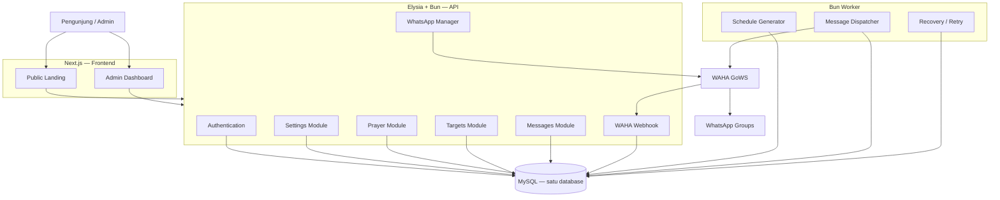

# 02 — Arsitektur & Struktur Repo

## 2.1 Diagram alir (sama dengan V2 §5.1, ditegaskan)



## 2.2 Tanggung jawab (kontrak antar komponen)

### Next.js (`apps/web`)
- Render landing + login + dashboard. Kelola UI state + form.
- Panggil Elysia via HTTP saja. **Dilarang**: akses MySQL, simpan `WAHA_API_KEY`, jalankan scheduler/kirim pesan.
- Countdown dihitung di browser dari `scheduled_at_utc` / waktu server — jangan hitung jadwal sendiri.
- Bila API gagal: tampilkan error jujur, **jangan tampilkan jadwal palsu/hardcoded**.

### Elysia API (`apps/api/src`)
- Auth admin (cookie HttpOnly + hash kuat), validasi semua input.
- CRUD settings/targets, sediakan jadwal landing, kontrol sesi WAHA via integration client, terima webhook WAHA, sediakan riwayat + status sistem, cek konektivitas DB.
- Satu-satunya yang boleh membaca `WAHA_API_KEY` selain worker.

### Bun Worker (`apps/api/src/worker/`)
- Jamin horizon H hari tersedia (default 7, lihat `06-worker-scheduler.md`).
- Buat job idempotent (`insert ... on duplicate key update nothing` / `insert ignore` + unique key).
- Ambil job jatuh tempo, klaim atomik, cek target aktif + sesi WAHA, kirim via WAHA, update status/attempt/error, jadwalkan retry, tandai expired/unknown, pulihkan sisa restart.
- Tulis heartbeat tiap 30 dtk ke `app_settings(worker_heartbeat)`.
- Timer in-memory **hanya optimasi**; sumber kebenaran tetap MySQL.

### WAHA GoWS
- Kelola sesi, QR, daftar grup, kirim teks, kirim event/webhook bila tersedia.
- **Tidak** menghitung jadwal / menentukan waktu kirim.

## 2.3 Struktur monorepo (wajib diikuti)

```text
unida-prayer/
├── apps/
│   ├── web/                      # Next.js + TS, frontend only
│   │   ├── app/
│   │   │   ├── (public)/         # / landing
│   │   │   ├── (auth)/           # /login
│   │   │   └── (admin)/          # /admin* dashboard
│   │   ├── components/           # UI generik (Button, Card, Badge, Dialog...)
│   │   ├── features/             # dashboard, whatsapp, prayer, targets, messages
│   │   ├── hooks/                # useCountdown, useHealth, dsb
│   │   └── lib/                  # api-client, time-format, error-map
│   └── api/                      # Elysia + Bun
│       └── src/
│           ├── modules/
│           │   ├── auth/         # login/logout/me/change-password
│           │   ├── settings/     # app_settings CRUD + validasi
│           │   ├── prayer/       # today/next/preview/recalculate
│           │   ├── whatsapp/    # session + test-message + groups/sync
│           │   ├── targets/      # list/patch target
│           │   ├── messages/     # history/detail/retry/cancel
│           │   └── system/       # health/ready/status
│           ├── integrations/waha/
│           │   ├── client.ts     # HTTP client + auth header, timeout, retry transport
│           │   ├── sessions.ts | groups.ts | messages.ts | webhooks.ts | types.ts
│           ├── database/         # client.ts, schema/, migrations/
│           ├── worker/           # index.ts, generator.ts, dispatcher.ts, recovery.ts
│           ├── core/             # config, logger, errors, time-utils
│           └── index.ts          # bootstrap Elysia
├── packages/
│   ├── shared/                   # tipe, konstanta status, error codes
│   └── prayer-engine/            # hitung + format + hijriyah (dipakai api & worker)
├── data/hadiths.json
├── infrastructure/docker/web.Dockerfile + api.Dockerfile
├── deploy/compose.yml            # TANPA MySQL
├── .github/workflows/build.yml
├── .env.example
├── package.json (workspace) + bun.lock + tsconfig.json
└── README.md
```

## 2.4 Aturan modul backend

- Per modul: `routes.ts` (endpoint) + `service.ts` (logika) + `schema.ts` (validasi) + `repository.ts` (query) + `types.ts` (bila perlu). **Jangan buat file kosong yang belum dibutuhkan.**
- Semua panggil WAHA lewat `integrations/waha/`. Dilarang `fetch(WAHA_...)` tersebar.
- Semua waktu tulis dalam UTC; konversi tampil di tepi (API response sertakan `timezone` + `*_utc`).
- Error konsisten (lihat `05-backend-api.md`).

## 2.5 Keputusan runtime

- Elysia + worker jalan di **Bun**.
- Next.js build `output: standalone` jalan di **container Node** (jalur prod Next yang stabil). Dependency tetap via Bun Workspace.
- Lihat `10-devops-cicd.md` untuk Dockerfile + Compose.
