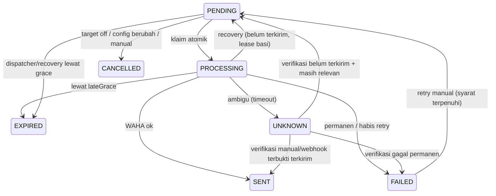

# 06 — Worker & Scheduler MySQL-backed

> Sumber kebenaran = `scheduled_messages`. Timer memory hanya optimasi. Satu worker MVP, tapi klaim tetap atomik.

## 6.1 Konstanta default (bisa jadi settings/internal, kunci di Q-WORK-01)

- Horizon: **7 hari** ke depan (termasuk hari ini).
- Tick generator: tiap **15 menit** + saat startup + setelah settings berubah.
- Tick dispatcher: tiap **15–30 dtk** (polling `PENDING` jatuh tempo + retry jatuh tempo).
- Retry: maks **3x**, jeda **30 dtk → 2 mnt → 5 mnt**.
- `lateGraceMinutes`: **5 mnt** (lewat itu → `EXPIRED`, jangan kirim).
- Heartbeat: tiap **30 dtk** ke `app_settings.worker_heartbeat`.
- Lease klaim `PROCESSING`: mis. **5 mnt** untuk deteksi stale (kunci Q-WORK-02).

## 6.2 Generator (idempotent)

Untuk tiap `date` dalam horizon × tiap target aktif × tiap kombinasi aktif (pre/adzan):

1. Hitung 5 waktu via `prayer-engine` (UTC + `prayer_date` lokal).
2. `scheduled_at_utc` = `prayer_time_utc` (ADHAN) atau `- preReminderMinutes` (PRE).
3. Render `message_body` snapshot + `content_ref` (hadits/template). Hadits diambil dari tabel `hadiths` (`is_active=true`, acak, hindari `content_ref` terakhir untuk anti-repeat); bila 0 aktif / `includeHadith=false` → pesan tanpa hadits.
4. `idempotency_key = sha256(prayer_date|prayer_name|message_type|targetDbId)`.
5. `INSERT ... ON DUPLICATE KEY UPDATE nothing` (atau `INSERT IGNORE`). **Jangan overwrite `SENT/FAILED`.**

Aturan:
- Target nonaktif → jangan buat job baru. Job PENDING milik target yang baru dinonaktifkan → `CANCELLED` saat regenerasi/sync (jangan kirim).
- Perubahan settings → regenerasi: hapus/tandai `CANCELLED` job `PENDING` masa depan yang kedaluwarsa aturan, lalu generate ulang. `SENT` tak tersentuh; `PROCESSING` jangan auto-ubah.
- Jumat: `prayer_name=DHUHR` tetap, isi body pakai label Jumat.

Pseudocode:

```ts
for (const date of next7DaysLocal()) {
  const times = calcPrayerTimes({ date, ...settings });
  for (const target of activeTargets) {
    for (const job of expandJobs(times, target, settings)) {
      await db.insert(scheduled_messages).values(job).onDuplicateKeyIgnore();
    }
  }
}
```

## 6.3 Dispatcher (klaim atomik → kirim → update)

Loop tiap tick:

1. `SELECT ... WHERE status='PENDING' AND scheduled_at_utc <= nowUtc AND (sendingEnabled) FOR UPDATE SKIP LOCKED LIMIT N` dalam transaksi → update ke `PROCESSING`, `claimed_at_utc=now`, `attempt_count+1`.
2. Untuk tiap klaim: cek target masih aktif + sesi WAHA WORKING + belum expired (`now - scheduled_at > lateGrace → EXPIRED`).
3. Kirim via `waha.messages.send(targetExternalId, message_body)`.
4. Sukses → `SENT`, `sent_at_utc=now`, simpan `waha_message_id`.
5. Gagal sementara (timeout/network/5xx/WAHA session down) → hitung `next_attempt_at_utc = now + backoff(attempt)` bila `attempt<max` dan belum lewat grace; else `FAILED`.
6. Gagal permanen (invalid target, rejected, 4xx validasi) → `FAILED` + `last_error` jelas.
7. Ambigu (timeout setelah kemungkinan terkirim, tanpa respons pasti) → `UNKNOWN`, **jangan auto-retry**. Tunggu verifikasi manual/webhook.
8. Satu target gagal **tidak** menghentikan target lain.

Backoff usulan: attempt1→+30s, attempt2→+2m, attempt3→+5m. Simpan `last_error` tanpa secret.

## 6.4 Recovery saat startup/restart

1. Tulis `workerId` baru + heartbeat.
2. Cari `PROCESSING` dengan `claimed_at_utc < now - leaseTimeout`:
   - Bila belum pernah kirim ke WAHA (tak ada `waha_message_id`, tak ada bukti kirim) → kembalikan `PENDING` (atau langsung jadwal retry).
   - Bila mungkin sudah terkirim (timeout lalu restart / ada `waha_message_id` parsial) → `UNKNOWN`.
3. Tandai `PENDING` yang sudah lewat grace → `EXPIRED`.
4. Jalankan generator untuk penuhi horizon.
5. Lanjut tick normal.

Jangan kirim ulang `SENT`. Jangan hapus riwayat untuk "bersih-bersih".

## 6.5 State machine



## 6.6 Pemicu regenerasi

- Admin ubah lokasi/timezone/metode/koreksi/pre-menit/toggle → `PATCH /settings` sukses → panggil `regenerateFuturePending()` (sync kecil atau job internal; kunci Q-API-01).
- Target dinonaktifkan → `CANCELLED`kan `PENDING` masa depan milik target itu.
- Target diaktifkan → generator akan membuat job ke depan (jangan buat job masa lalu).

## 6.7 Observabilitas worker

- Heartbeat JSON tiap 30 dtk. Dashboard hitung healthy/warning/offline (lihat `09-security-logging-monitoring.md`).
- Log terstruktur per klaim/kirim/gagal/recovery dengan `idempotency_key`, `prayer_date`, `target_id` — tanpa isi pesan penuh bila sensitif? (isi pesan bisnis, bukan secret — boleh ringkas; kunci Q-LOG-01).
- Metrik hitung untuk `/system/status`: todaySent, pending, failed/unknown.
